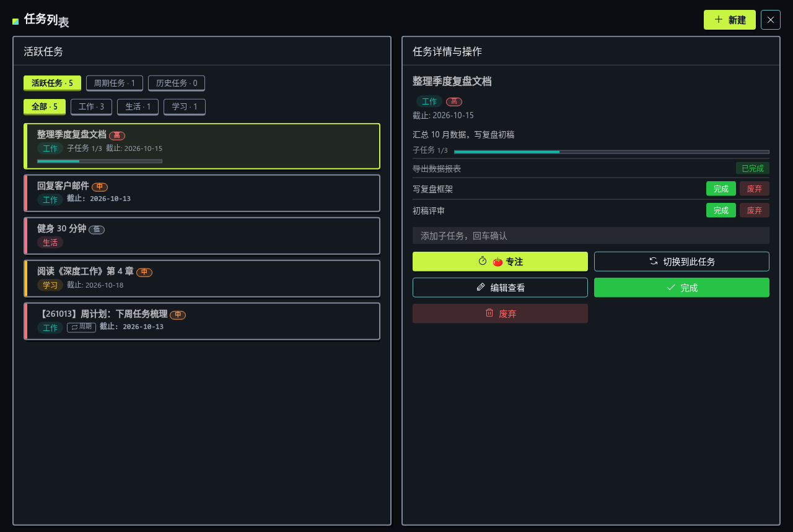
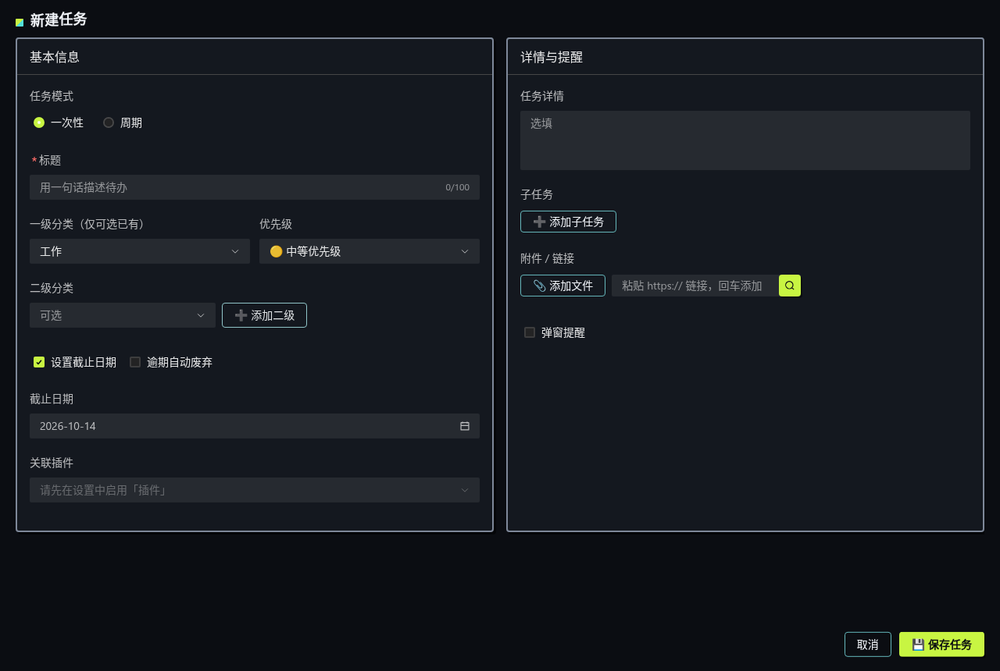
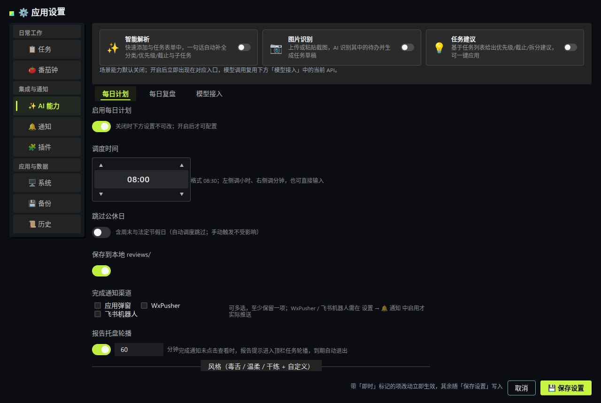

# ZenTray 用户使用手册

> 版本：与 `zentray/config.py` 中 `VERSION` 同步。规则见 [VERSIONING.md](VERSIONING.md)。  
> 开发说明见 [README.md](../README.md)、[FRONTEND_VUE.md](FRONTEND_VUE.md)。

---

## 目录

1. [产品是什么](#1-产品是什么)
2. [通用概念](#2-通用概念)
3. [安装](#3-安装)
4. [日常使用](#4-日常使用)
5. [设置](#5-设置)
6. [插件](#6-插件)
7. [数据与备份](#7-数据与备份)
8. [故障排查](#8-故障排查)

---

## 1. 产品是什么

系统托盘常驻的个人效率工具：**无主窗口**。

| 能力 | 说明 |
|------|------|
| 顶栏看板 | 活跃任务标题轮播；左：优先级饼图（色=紧急程度，填充=进度） |
| 番茄钟 | 专注-短休/长休循环；左：番茄/休息饼图随倒计时填充；右：倒计时或自定义文案 |
| AI | 每日计划 + 每日复盘（插件朝闻/暮省，随关联周期任务调度） |
| 通知 | 应用弹窗 + WxPusher + 飞书机器人（可同时开）；应用弹窗可点击（脚本完成通知点击即开 html/md 报告） |

任务（含周期、闪电添加 `Ctrl+Alt+T`）等日常操作见[第 4 章](#4-日常使用)配图说明。

**习惯：**

- 启动后请看**屏幕顶栏/托盘**，不要找主窗口。  
- **右键托盘图标**打开菜单。  
- 关闭对话框 ≠ 退出；退出请用菜单「退出程序」。

---

## 2. 通用概念

### 2.1 任务饼图（非番茄）

扇形填充 = 当前任务的**子任务完成比例**（10% 步进；无子任务为空饼；满完成即实心满圆）。

| 优先级 | 颜色 |
|--------|------|
| 高 | 红（**无**绿点） |
| 中 | 黄 |
| 低 | 绿 |

### 2.2 番茄钟图标

- 与菜单 🍅 同语义：**红果 + 绿萼**，果体随专注进度饼状填充（已消耗时间比例）。  
- 休息段为**茶绿色圆饼**（无萼）；右侧文字为倒计时或自定义文案（见 设置 → 🍅 番茄钟）。

### 2.3 标题前缀

- 分类：成对括号包住 `一级-二级`，如 `[工作-需求]`。  
- 逾期：可配置前缀如 `【已逾期】`。

### 2.4 数据目录

| 系统 | 路径 |
|------|------|
| Linux | `~/.local/share/ZenTray/` |
| Windows / macOS | `~/.ZenTray/` |

主要：`active_tasks.json`、`settings.json`、`periodic_templates.json`、`archive/`、`reviews/`、`icons/`、`zentray.log`。

---

## 3. 安装

### Ubuntu / Debian

#### 安装前

- [ ] amd64 桌面环境  
- [ ] 建议：AppIndicator（`gir1.2-ayatanaappindicator3-0.1`、`python3-gi`）  
- [ ] 可选：`libnotify-bin`

#### 安装

```bash
sudo apt install -y ./zentray_*_amd64.deb
zentray
```

#### 注意

- 仅图标无文字：安装/启用 AppIndicator 支持。  
- 再点桌面图标：只刷新托盘，不新开进程。  
- Wayland 下热键可能不可用，请用托盘菜单。

### Windows

- 包：`zentray_*_windows_x64.zip`（x64，免安装）。解压到任意目录，运行 `ZenTray/ZenTray.exe`。
- 未签名：SmartScreen 提示时选「更多信息 → 仍要运行」。
- 数据目录 `~/.ZenTray/`；开机自启走 HKCU Run（设置 → 🖥️ 系统）。

### macOS

- 包：`zentray_*_macos_arm64.zip`（仅 arm64）。解压得 `ZenTray.app`，拖入「应用程序」。
- 未公证：首次打开被 Gatekeeper 拦属预期——系统设置 → 隐私与安全性 → 仍要打开；或终端执行 `xattr -dr com.apple.quarantine /Applications/ZenTray.app`。
- 数据目录 `~/.ZenTray/`；全局热键走 Carbon，开机自启走 SMAppService（设置 → 🖥️ 系统）。

---

## 4. 日常使用

### 启动节奏

1. 刚启动：仅应用图标。  
2. 片刻后：饼图 + 任务标题轮播。

### 速览面板（Windows）

左键托盘图标呼出：当前轮播任务卡（优先级/截止/子任务进度）+ 番茄钟状态与控制，◀▶ 沿活跃序换位，ESC 关闭。


### 任务

菜单「📋 任务列表」打开任务列表页：



- **活跃 / 周期 / 历史** 三视图页签 + 分类筛选（如上图）；点选卡片后右侧详情面板管理**子任务**（回车添加、逐项完成/废弃，完成度自动汇总为进度条），并可**编辑 / 完成 / 废弃**；周期模板可预设子任务。
- 快捷键闪电添加 `Ctrl+Alt+T`（可在 设置 → 📋 任务 「闪电添加」关闭、改键，并设默认分类/优先级）：


- 新建/编辑表单（一次性/周期模式，字段如上图）：



- **时间四要素（⏰ 时间与提醒分组，全部勾选后可设）**：
  1. **开始时间**——不勾=创建/派发后立即开始；勾选瞬间预填默认值（日期：一次性=当天、日周期=仅时分、周周期=周一、月周期=1 号；时分=分类提醒时间窗起点，未启用则 00:00）。到点前不轮播不弹窗，已过视为立即；
  2. **截止时间**——不勾=无截止、永不逾期；勾选预填（一次性=当天、日周期=每天、周周期=周日、月周期=月底，2 月自动钳到月末；时分=时间窗终点，未启用则 23:59）。**逾期按截止时分分钟级判定**，未设时分按当日 23:59；
  3. **弹窗提醒**——勾选后**截止时刻自动弹窗一次**（改截止即改弹窗时刻，改时刻会重新弹）；可「➕ 添加弹窗时间」另加多个时间点，各自到点一弹；
  4. **跳过公休日**——提醒与轮播跳过周末/法定节假日（任务级开关，新建时按分类预设带出）。
- **分类提醒预设**：设置 → 📋 任务 每个一级分类可预设**轮播提醒时间范围**（如工作 9:00-18:00，支持跨夜，默认关）与**是否跳过公休日**；范围内/外的任务才进入（或退出）顶栏轮播，新建任务自动继承。
- **提醒弹窗**：到点弹出的提醒卡有五个操作——**完成**（主按钮）、**稍后 N 分钟**（输入框默认 30、步进 5，可直接改）、**跳转**（直达任务列表定位该任务）、**忽略本次**（本次不扰，下个提醒点再来）、**废弃**（归档为已废弃，需二次确认，不可恢复）。
- **附件/链接**：任务编辑页可添加附件（系统文件选择）或链接（粘贴 URL）；详情页图片显示缩略图、链接点击跳浏览器、文本/Office 文件用系统默认应用打开。

### 番茄钟

1. 菜单「🍅 专注…」按钮（空闲时融合今日统计，如「🍅 专注25mins -- 今日75mins」，格式见 设置 → 🍅 番茄钟）；或在**任务列表选中任务 → 🍅 专注**，以该任务为对象开始（菜单显示专注中的任务，记录带任务标题）。  
2. 顶栏左：番茄饼图进度；右：倒计时或文案（见设置）。  
3. 专注结束自动进入**短休**（默认 5 分钟），每 N 个专注（默认 4）进**长休**（默认 15 分钟）：顶栏换茶绿饼图，菜单可「⏭ 跳过休息」。  
4. 专注中可延长 / 中止（中止 ≥1 分钟记入历史）；休息结束默认不自动开始下一段专注（可在设置开启）。  
5. 今日统计空闲时融合在专注按钮里，专注/休息中单列「今日 🍅 X · Y 分钟」一行；设置「每日目标」达标当次弹通知 🎉；全部专注记录见 设置 → 📜 历史。

### AI

- **每日计划 / 每日复盘** 已插件化为 **朝闻**（计划）/ **暮省**（复盘）：随**关联的周期任务**调度（默认日周期，到点弹窗并自动运行插件，v0.7.15 前的参数预设已在升级时自动迁移为关联任务）；「保存到 reviews/」等运行参数在 设置 → 🧩 插件 → 参数预设 中设置。
- **AI 风格**（毒舌/温柔/干练 + 自定义提示词）仍在 设置 → ✨ AI 能力 → 每日计划与复盘 分别维护，插件生成时读取。
- 完成通知与「📄 插件报告待查看」托盘轮播走插件报告通用链路（渠道与时长见 设置 → 🔔 通知 / 🧩 插件）。
- 多 API 配置时，**只能启用一个**。

**场景能力**（设置 → AI 能力 顶部开关，默认全部关闭，开启后入口即刻出现）：

- **✨ 智能解析**：快速添加（`Ctrl+Alt+T`）与任务表单页。输入一句话（如「明天下午三点开版本评审会，要带灰度数据」）点 ✨，AI 生成草稿预览——标题/分类/优先级/截止/提醒/子任务逐项确认后应用。快速添加中「确认添加」直接建任务；表单中「应用到表单」回填各字段（分类按名称匹配，匹配不上保持当前）。
- **📷 图片识别**：任务表单页点「图片识别」选图，或直接 **Ctrl+V 粘贴截图**。识别出多条时先选一条，再进草稿预览。
- **💡 任务建议**：任务列表选中任务后，右卡顶部「AI 建议」给出优先级/截止/拆分等建议——带「应用」按钮的一键生效（提级/改截止/追加子任务），纯文本提醒（复盘/清理）仅展示，「忽略」逐条消掉。

### 退出

托盘菜单 → 退出程序。

---

## 5. 设置

### 窗口行为

所有应用窗口：
- **默认居中显示**：打开时自动出现在屏幕中央
- **可拖拽移动**：点击窗口任意空白位置即可拖动（避开按钮、输入框等交互区域）
- **拖动后不回弹**：同一窗口拖动后不会再被拉回中心（重新打开的新窗口仍默认居中）

左侧导航分三组——**日常工作**（任务 / 番茄钟）、**集成与通知**（AI 能力 / 通知 / 插件）、**应用与数据**（系统 / 备份 / 历史）（下图为 🖥️ 系统 页）；改完立即生效的项带「即时」标记，其余随底部「保存设置」写入：



| 页 | 内容 |
|----|------|
| **✨ AI 能力** | 自上而下三段：**模型接入**（多 API 折叠行，同时启用一个，状态点亮行首）、**场景能力开关卡片**（智能解析 / 图片识别 / 任务建议，默认关）、**每日计划与复盘**（左右双栏分别维护计划/复盘的 **AI 风格** 提示词；调度与通知已迁移至插件 朝闻/暮省） |
| **🔔 通知** | 固定渠道：应用弹窗、WxPusher、飞书机器人（可同时开，点击行展开配置） |
| **📋 任务** | 各优先级停留秒数、模式；逾期轮播与前缀；分类管理（标题括号/分隔符、二级开关、一二级增删改）；闪电添加开关与默认参数；**飞书同步**（任务单向推送飞书「ZenTray」日历与任务清单，配置见[飞书同步配置](FEISHU_SYNC.md)）；**系统日历**（订阅源自动同步，见下节） |
| **🍅 番茄钟** | 三组满宽排布：专注时长（含节奏预设经典 25/5、深度 50/10、超长 90/20，当前值恰合预设时高亮）、延长；休息与循环（短休/长休/长休间隔、自动休息/自动专注、每日目标）；托盘与菜单（右侧倒计时/文案、图标叠加、按钮融合文案，占位符 {focus}/{today}/{count}） |
| **🧩 插件** | 插件总开关、已安装插件管理（说明/参数预设/编辑/删除）、导入——详见[第 6 章](#6-插件)；运行与历史在托盘插件面板 |
| **🖥️ 系统** | 外观（主题/皮肤/动效/形状，如上图）、开机自启、软件更新（应用内检查新版本、下载安装并重启）；Windows 另有**状态条显示**——任务栏正上方全宽条带（动态图标+完整任务标题，左键速览/右键菜单，系统级保留不遮挡），可关、可开超宽跑马灯 |
| **💾 备份** | 五卡片：备份存储目录、手动即时备份、自动周期备份策略、从备份文件恢复、历史备份快照——详见[第 7 章](#7-数据与备份) |
| **📜 历史** | 只读单页：日期侧栏 + 合并时间轴 + 详情 |

通知渠道固定为 **应用弹窗**、**WxPusher** 与 **飞书机器人**（不可自增删，可开关）。

**飞书机器人**：在飞书群「设置 → 群机器人 → 添加自定义机器人」获取 Webhook 填入即可；消息在**飞书群内接收**（需飞书 App 且在该群）。建议在飞书侧开启**签名校验**并填入密钥（Webhook 等同凭证，勿外传）。

### 系统日历订阅

设置 → 任务 → **系统日历**：开启后 ZenTray 在数据目录维护一个日历源文件 `calendar/zentray.ics`，任务增删改、周期模板变更都会自动重写它——你的日历应用**订阅一次该文件**即可长期保持同步（无需反复导入）。卡片上可打开源文件夹、复制订阅链接、或「导出一次」生成 .ics 手动导入。

各平台订阅方式：

| 平台 | 做法 |
|------|------|
| **Linux** | Evolution：日历列表 → 新建日历 → 类型选「本机文件」，选中源文件；KOrganizer/GNOME Calendar 经 Evolution 数据源显示。订阅后文件变化即时/定时刷新 |
| **macOS** | 日历 App → 文件 → 新建日历订阅，粘贴卡片上「复制订阅链接」得到的 `file://…/zentray.ics`；可设自动刷新（默认每小时） |
| **Windows** | Outlook 不支持本地文件订阅：用卡片「导出一次」生成 .ics 导入（同一文件重复导入是**更新**不会重复建事件） |

- 事件规则：截止日=全天事件；截止弹窗与自添弹窗时间=「⏱ 提醒」30 分钟定时事件
- **周期模板未来日程**：新建/编辑周期任务时可开「生成未来日程到系统日历」，选择投影「未来几次（1–60）」或「未来几天（7–365）」；暂停、跳过中、已过停止日的模板不会投影；已派发的真实实例与投影自动去重
- 关闭开关后源文件清空为空日历，订阅方的事件随之消失

---


## 6. 插件

### 6.1 开启与设置页结构

1. 托盘菜单 → **设置** → **🧩 插件**。
2. 打开 **启用插件**，保存设置。

启用后内置与用户插件目录**恒扫描**（单一总开关，无分项加载开关）。设置页只做**管理**，
按三个区块组织（总开关 / 已安装插件 / 导入插件）；**运行插件与查看历史在托盘插件面板**
（见 6.4），设置页不再提供运行入口：

| 区块 | 功能 |
|------|------|
| **总开关** | 启用插件 / 运行报告托盘轮播 |
| **已安装插件** | 按名称排序，每插件一行：类型色点（绿=脚本 / 橙=服务）+ 名称 + 一句简介 +
  自动运行提示（如「⏱ 每日 08:30」）；行尾四动作——**说明**（抽屉查看详情/参数表/README
  使用说明）、**参数预设** / **编辑**（同一展开面板：改名称/简介写回 plugin.yaml、参数预设、
  自动运行授权开关、**通知渠道多选**；示例插件保存时自动复制到用户目录）、**删除**（用户目录插件移除目录；
  示例插件从列表隐藏，安装文件保留）；校验失败明细在列表下方 |
| **导入插件** | 一个切换按钮选 **zip 包 / 目录**；路径输入默认填内置插件目录（便于复制改造示例）；**先预览校验，成功提示后才能点安装**；同名重复安装会询问覆盖；「高级」里可改用户插件目录（安装目标，留空 = 数据目录 `plugins/`） |

手动复制目录到用户插件目录同样有效（点「刷新」即重扫）。

### 6.2 随任务调度（v0.7.15 起）

插件**没有自身调度**（旧版的定时/间隔/cron/事件触发与一次性授权已删除）。
自动运行的唯一触发源是**所关联任务的弹窗时刻**：

- 在任务的「时间与提醒」里勾选**截止弹窗**或添加**弹窗时间**，再在「关联插件」里选中插件；
  该任务每个弹窗时刻到点，弹窗照常弹出，插件**并行自动运行**（入参取参数预设）。
- 定时需求建模为周期任务：如「每周五 09:30 跑周报」= 周周期模板（截止周五 + 截止弹窗
  09:30）+ 关联插件；**跳过公休日**等提醒门控对插件同样生效（弹窗静默日插件同静默）。
- **关联即授权**：把插件关联到任务就是显式允许，没有额外授权弹窗。
- 番茄钟进行中或已有脚本运行时静默跳过（不弹通知）；开启了 `write_back` 的插件运行后把结果写回任务备注。
- 朝闻/暮省旧参数预设（周期/时刻/跳过）升级后自动迁移为关联周期任务；其余第三方插件
  请手动新建关联任务或从插件面板手动运行。

### 6.3 参数预设

声明了入参的插件（见 [插件规范](plugins/PLUGIN_SPEC.md) 3.5）可在设置页展开保存
每个参数的预设值（单组，存 `ops.param_presets`）；**可变长度参数**（`variadic`，仅最后一个
参数可声明）默认一行输入，「＋ 加一条」增行，多值按序传给脚本。运行取值优先级：
**显式传入 > 预设 > 缺省值**；自动触发按 预设 > 缺省 取值。

### 6.4 运行（🧩 插件面板）

托盘「🧩 插件」是**单一菜单项**（GNOME 托盘不支持向右弹出的子菜单，插件列表统一
收入应用内面板）：点击打开**插件面板**——顶部分类 chips + 类型筛选，逐插件一张卡
（手风琴展开）：


| 类型 | 面板行为 | 顶栏 |
|------|----------|------|
| **脚本（无入参）** | 点卡头 **▶ 运行** 直接运行 | 进度文案（`⚡ …`）**暂时替代**任务轮播；结束后恢复 |
| **脚本（有入参）** | 点卡头 **▶ 运行** 展开**参数表单**：预填 预设→缺省值，可修改后运行（收起即中止） | 同上 |
| **服务** | 卡头 **▶ 启动**；卡身 [停止] / [状态] | 短通知提示，不占用轮播 |

- 卡头 **▶ 运行 / ▶ 启动** 为独立实心主色按钮；另有 **[说明] / [报告] / [日志]** 文字按钮：说明打开使用说明抽屉；报告用**系统应用打开**（结果正文含 html 报告路径 → 浏览器，否则生成 md 用系统阅读器）；日志查看完整日志抽屉。
- **插件通知渠道为插件级**：每个插件的展开面板里多选（选项 = 设置 → 🔔 通知中已开启的渠道）；未选择时按迁移前的全局渠道回退，再空则跟随全局已启用渠道；渠道后来被关闭时发送端自动跳过。
- **通知格式可自定义**：设置 → 🔔 通知「插件通知格式」——标题/正文模板（占位符 `{name}` `{status}` `{summary}` `{result}`），下方实时预览；默认值与旧版固定格式一致。
- 脚本完成通知**未点击查看**时，「📄 插件报告待查看」进入顶栏任务轮播（到期或点开报告后退出）；开关与时长在 设置 → 🧩 插件 总开关区。

**「记录」标签**——运行历史表（运行ID / 插件 / 触发 / 开始 / 结果 / 摘要），
可按插件过滤；**点行打开执行报告抽屉**：状态 / 起止 / 耗时 / 触发 / 关联任务 /
摘要 / 结果正文（插件 `RESULT` 行）/ 完整日志。

- 脚本运行中不能开番茄钟；番茄进行中不能跑脚本（双向拦截；运行中面板按钮置灰）。
- 运行历史与日志集中在插件面板**「记录」标签**（设置页不再展示）；日志目录：数据目录下 `ops_runs/`。

### 6.5 任务关联插件

任务表单（新建/编辑）中可选择「关联插件」并就地试运行；任务详情右卡有「▶ 运行关联插件」
按钮（运行时自动带上该任务上下文，结果可在**插件面板「记录」标签**查看）。
**关联后，插件在本任务的每个弹窗时刻自动运行**（见 6.2）。
周期任务同样支持——模板派发的实例会继承关联。

### 6.6 内置示例

| 插件 | 分类 | 说明 |
|------|------|------|
| **AI 资讯日报**（`ai-news-digest`，v2） | 资讯 | 聚合 HN 与主流媒体 RSS 生成带图 HTML 日报：数码/AI/时政分组、卡片可点进详情页，标题中英对照，可选 AI 摘要；入参 `top_n` 控制条数；关联任务后随弹窗时刻运行 |
| **邮箱日报**（`email-digest`，v2） | 工具 | 汇总多个邮箱自上次运行以来的新邮件为一份日报（IMAP 只读不置已读，password / XOAUTH2 双轨认证）；关联任务后随弹窗时刻运行，结果写回任务备注 |
| **文本工具箱**（`text-toolbox`） | 工具 | 本地文本工具页：JSON/SQL 处理、文本比对合并、时间工具（万年历含当日任务、时间戳互转）、随机字符串、哈希/编码/加解密；service 型启停 |

完整说明见仓库 `bundled_plugins/<id>/README.md`。

### 6.7 与业务的关系

VPN 切换、邮箱相关等**具体操作**由你自己的插件实现；应用只负责发现、校验、触发与展示进度。可复制内置示例目录改 `id`/`run.sh` 作为模板。

---

## 7. 数据与备份

设置 → **💾 备份**，五张卡片：

1. **备份存储目录**：默认 `~/.local/share/ZenTray/exports`，可「更改目录」换到任意位置（如网盘同步目录），更改后点底部「保存设置」生效；「恢复默认」回到 exports。
2. **手动即时备份**：勾选备份内容（默认六项；`.env` 含 API Key 谨慎勾选），可开启 **密码加密（AES-256）**——恢复时必须输入同一密码。三个动作：
   - **立即备份**：写入备份存储目录
   - **另存为…**：原生对话框选任意位置保存
   - **仅打包归档**：只打包任务归档目录
3. **自动周期备份策略**：开启后按设定频率（每天 / 每 3 天 / 每周）在指定时刻自动全量备份（**明文不加密**），到点未开机会在下次启动后补跑；「保留份数」自动轮转，**只清理自动备份自身**（`zentray-auto-*`），不动手动导出。
4. **从备份文件恢复**：「选择文件」或手输本机 zip 路径 → **预览内容**（只读展示包内各类/子类计数：任务分一次性/周期实例并附模板分布、设置分节、复盘分类型、归档分月、插件逐个）→ 勾选树选择恢复范围 → 恢复（**替换模式**；勾选父项=整类替换，勾选子项=仅替换对应分区、其余保持本地现状；操作前自动写入安全备份）。加密包需输入密码；密码错误会明确提示。
5. **历史备份快照**：备份目录内所有 zip 列表（文件名/大小/时间/类型/是否加密），支持恢复、删除、刷新。

> 加密备份为 AES-256 zip：恢复请用本应用；系统自带 unzip 可能不支持 AES，第三方解压请用 7-Zip。

重装一般不删用户数据；跨设备迁移用「手动即时备份 + 从备份文件恢复」即可。
用户插件目录（`plugins/`）为备份可选项，需要时在「手动即时备份」勾选；`ops_runs/` 运行日志不在备份范围。

---

## 8. 故障排查

| 问题 | 处理 |
|------|------|
| 以为没启动 | 查顶栏/托盘与 `zentray.log` |
| 高优先饼图有绿点 | 已修复；可删 `icons/.pie_icons_version` 后重启重生图标 |
| 番茄不像番茄 | 同上重生 `tomato_*.png`；确认在专注状态 |
| 设置页是旧的 | 确认已 `npm run build` 且未设 `ZENTRAY_UI=qt` |
| 无顶栏文字 | Linux 安装 AppIndicator 支持 |
| 每日计划/复盘没到点 | 关联的周期任务弹窗设置正确（截止弹窗时刻）且未跳过公休日；API Key 有效；插件总开关已开；番茄中/脚本运行中会静默跳过；看日志「插件随任务弹窗运行」 |
| 计划只在约 8 点跑 | 旧版仅匹配整点小时且内存记「今日已跑」；升级后确认设置里的调度时间已保存 |

```bash
# 强制重生托盘图标
rm -f ~/.local/share/ZenTray/icons/.pie_icons_version
# 然后重启 zentray
```
